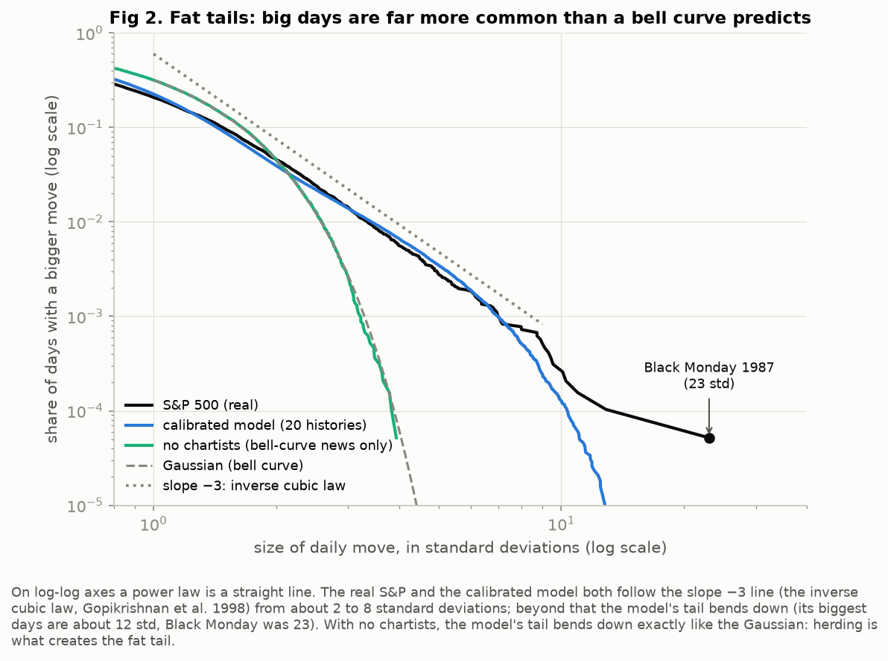
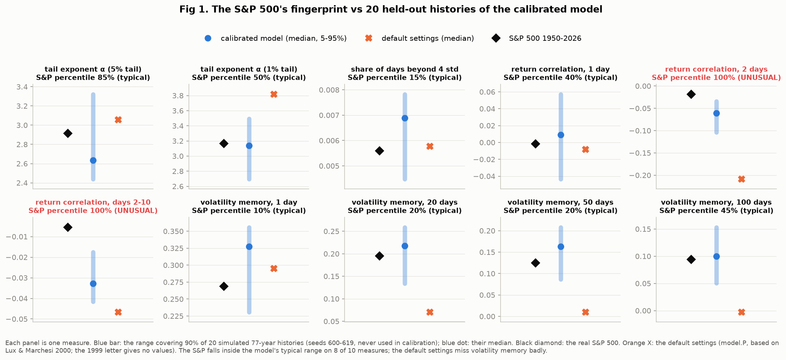
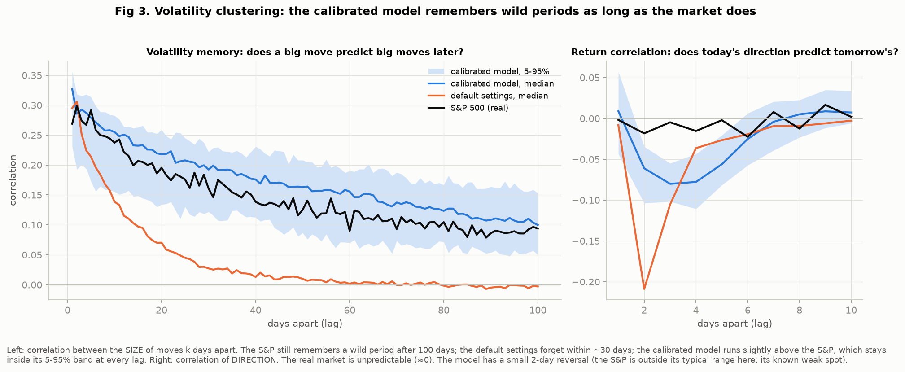
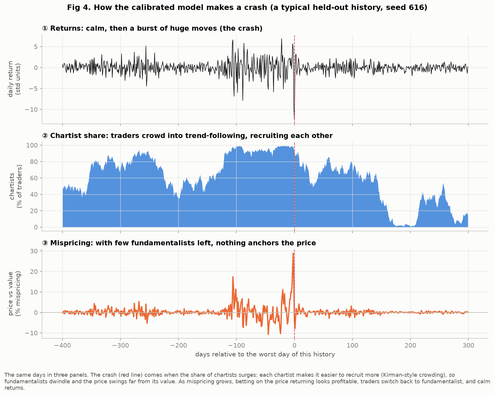
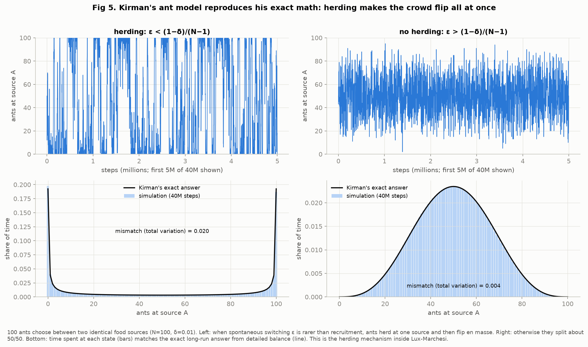
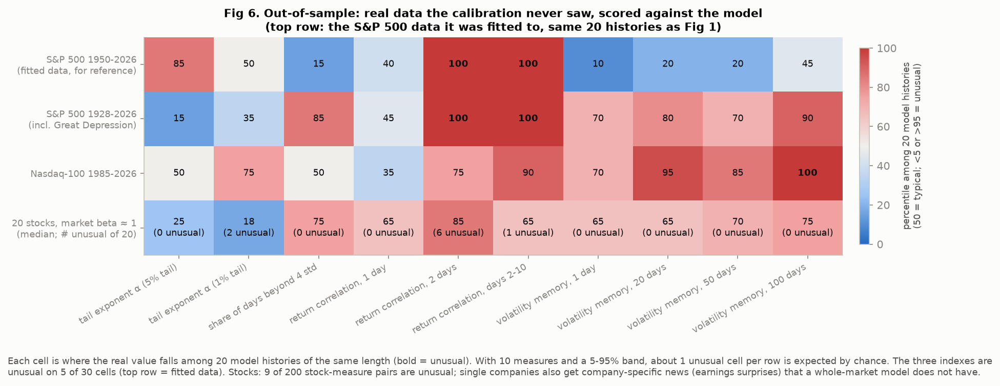
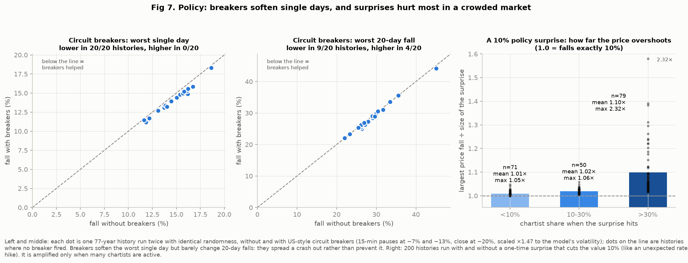
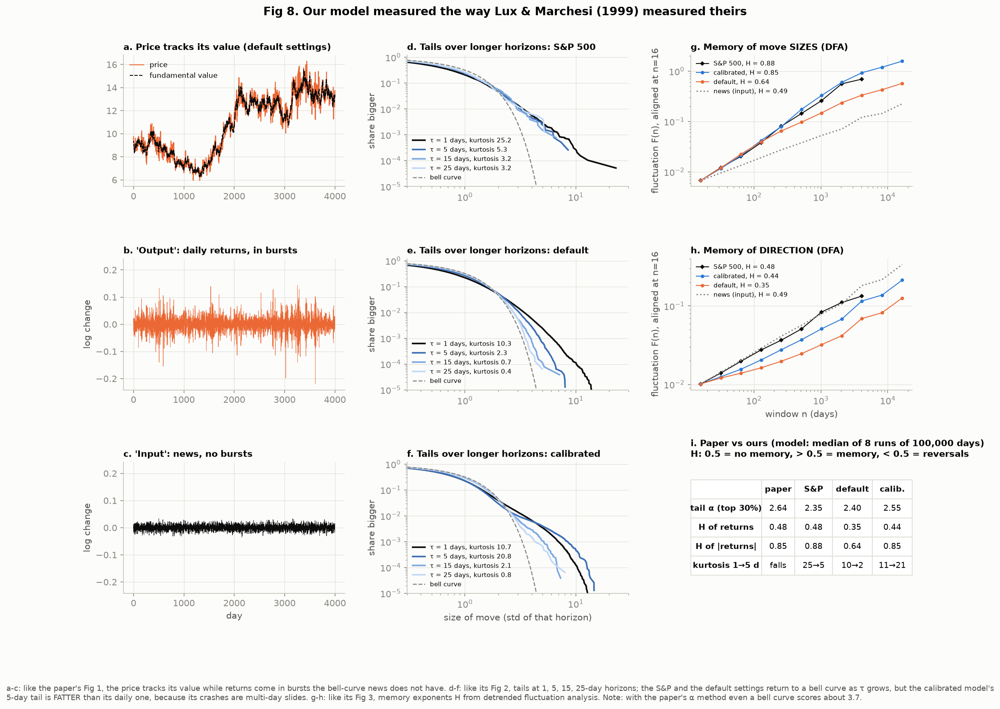
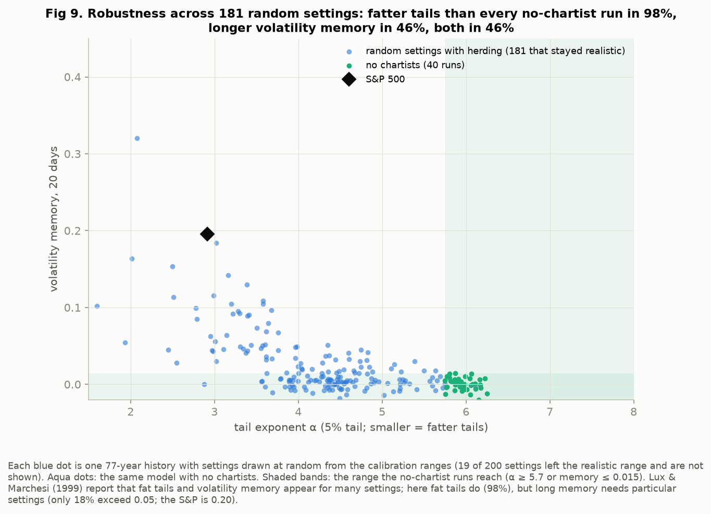

# Key points: Can herding explain market crashes?

A self-contained guide to this project, written for someone who has never seen it
and doesn't know finance or agent-based modeling. It explains the ideas behind the
code, what each figure shows, how to read it, and what the model gets right and
wrong. Every number below comes from code in this repository and can be
reproduced (section 10). Detailed figure notes are in [`figures/RESULTS.md`](figures/RESULTS.md).

---

## 1. The question in one paragraph

Stock markets have two famous habits. First, **huge days happen far more often than
a bell curve predicts**: Black Monday (19 October 1987), when the S&P 500 fell 20.5%
in one day, was a 23-standard-deviation event, which a bell curve says should
essentially never happen. Second, **wild days come in bunches**: a violent week is
usually followed by more violent weeks. A popular view in economics, the *efficient
market hypothesis*, says prices simply react to news, so big swings must come from
big news. This project tests the opposite idea, from **Lux & Marchesi (1999,
*Nature*)**: even when the news is perfectly calm and bell-shaped, traders copying
each other can create crashes on their own. We build their model, fit it to 77 years
of real S&P 500 data, and check whether **herding alone** reproduces the real
market's fat tails and clustering.

## 2. Words you need

| Word | Meaning |
|---|---|
| **Return** | How much the price changed in a day, measured as a log change (about the percentage change). |
| **Standard deviation (std)** | The typical size of a daily move. A "10-std day" is ten times bigger than a typical day. |
| **Bell curve (Gaussian)** | The shape random noise usually has: moves beyond 4–5 std are almost impossible. |
| **Fat tail** | Big moves are far more common than the bell curve allows. |
| **Tail exponent α** | How quickly big moves become rare. Smaller α = fatter tails = more crashes. Real markets: α ≈ 3 (the "inverse cubic law", Gopikrishnan et al. 1998). |
| **Kurtosis** | One number for tail fatness: 0 for a bell curve, larger = more extreme days. |
| **Volatility clustering / memory** | Big moves come in bunches: the size of today's move predicts the size of moves weeks later. |
| **H (Hurst exponent)** | A memory number from *detrended fluctuation analysis* (DFA). 0.5 = no memory; above 0.5 = patterns persist; below 0.5 = patterns reverse. |
| **Fundamental value** | What the asset is "really worth" (its future earnings). In the model it's moved only by news. |
| **Fundamentalist** | A trader who buys below the fundamental value and sells above it. Pulls the price back toward value. |
| **Chartist / noise trader** | A trader who ignores value and follows the trend and the crowd. Split into **optimists** (buy) and **pessimists** (sell). |
| **Herding** | Traders copying what other traders do. |
| **Agent-based model** | A simulation made of many individual "agents" (here, 500 traders) following simple rules; the market's behavior emerges from their interactions. |
| **Calibration** | Searching for the model settings whose output looks most like real data. |
| **Held-out seeds** | The model is random. A *seed* fixes the random numbers. We judge the model on seeds the calibration never used, so it isn't graded on its own homework. |
| **Percentile** | Where the real market falls among 20 simulated histories: 50% = perfectly typical; below 5% or above 95% = unusual. |

## 3. The model in plain words

Imagine 500 traders. Each day is cut into 100 small steps (`dt = 0.01`). In every step:

1. **News** moves the fundamental value by a small bell-curve random amount. This is
   the only outside input, and it has no fat tails and no clustering.
2. **Chartists change mood.** An optimist may turn pessimist, or the reverse. They are
   pushed by the **majority mood** (herding, setting `a1`) and by the **price trend**
   (trend-following, `a2`).
3. **Traders change strategy.** Fundamentalists and chartists compare profits:
   chartists earn from price trends; fundamentalists earn from the gap between price
   and value, discounted (by a factor `s` below 1) because that profit arrives later.
   Crucially, switching is **recruitment**, the more chartists there are, the easier
   it is to recruit more (Kirman's ant model, section 5).
4. **The price moves** with excess demand: more buyers than sellers pushes it up.

The chance that a trader switches within a step is `1 − e^(−rate·dt)`, where the
rate grows exponentially with how attractive the other group is. The code is
[`herding/model.py`](herding/model.py); the measurements are in [`herding/stats.py`](herding/stats.py).

**Two versions of the settings are compared throughout:**
- **Calibrated** (blue in every figure): fitted to the S&P 500 (1950–2026) by
  [`herding/calibrate.py`](herding/calibrate.py), saved in `calibrated_params.json`.
- **Default** (orange): `model.P`, based on Lux & Marchesi (2000), partly changed by us
  when prices were rewritten in logarithms. The 1999 letter gives no numbers.

## 4. How the model is checked

- Every check uses **20 simulated 77-year histories** on held-out seeds, because one
  history can be calm and another wild even with identical settings.
- The real market is judged as **typical** if it falls inside the middle 90% of the
  simulated histories (percentile 5–95%).
- **511 automated tests** in [`tests/`](tests/) check every function against
  answers known independently: exact math (e.g., Kirman's formula, a Pareto law
  with known α, white noise with H = 0.5), published facts (Black Monday's −20.5%),
  and guardrails that reject bad inputs. Known model weaknesses are recorded as
  "expected failures", so they're measured rather than hidden.

## 5. Key findings, with the evidence

### Finding 1. Herding alone creates fat tails. *(the central result)*

- **How to read:** a log-log plot; a straight line means a power law. The x-axis is
  move size (std), the y-axis the share of days with an even bigger move.
- **What it shows:** with **no chartists** (aqua), the model's tail drops like the
  bell curve. With herding (blue), it follows the real S&P (black) along the
  slope −3 line from about 2 to 8 std. The news is identical in both runs, so the
  fat tail comes from the traders.
- **Honest catch:** the model's biggest days are about 12 std, while Black Monday
  was 23 (see Finding 6).

### Finding 2. The real S&P 500 looks like a typical model history on 8 of 10 measures.

- **How to read:** each panel is one measure (tail exponents, share of days beyond
  4 std, return correlations, volatility memory). Blue bar = the middle 90% of 20
  model histories; black diamond = the S&P; orange X = default settings.
- **What it shows:** the S&P is inside the range on 8 of 10. The two misses are the
  2-day and days 2–10 return correlations: after a big move the model partly
  reverses it, and the real market barely does.

### Finding 3. Wild periods are remembered for months, as in the real market.

- **Left:** correlation between the *sizes* of moves k days apart. The S&P still
  remembers a wild period after 100 days (0.09); the calibrated model does too,
  while the default settings forget within about 30 days.
- **Right:** correlation of *direction*. The real market's is about 0 (unpredictable);
  the model has the small reversal from Finding 2.

### Finding 4. How a crash happens: crowding into trend-following.

- **How to read:** the same 700 days of one typical history in three panels:
  returns, the share of chartists, and how far the price is from its value.
- **The cycle:** a few chartists recruit more, and their share snowballs to nearly
  100%. With almost nobody anchoring the price to its value, it swings up to 29%
  away and returns burst to 12 std. Then the big mispricing makes fundamentalist
  trading profitable again, traders switch back, and calm returns.
- **The answer to the project question:** crashes come from traders herding into
  the *strategy* of trend-following, not from bad news and not mainly from
  optimists agreeing with each other.
- Across 20 histories, volatility is 0.67× its average when under 10% of traders are
  chartists and 2.97× when over 90% are: the paper's "critical fraction" story.

### Finding 5. The herding building block matches Kirman's exact math.

- 100 ants choose between two identical food sources, switching on their own or by
  being recruited. When recruitment dominates, the ants **herd** (left: all at one
  source, then a mass flip); otherwise they split 50/50 (right). The simulated time
  at each state matches Kirman's exact formula (mismatch 0.020 and 0.004).

### Finding 6. Markets the model never saw also look typical, mostly.

- **Rows:** the fitted S&P (reference), the S&P since 1928 (with the 1929 crash and the
  Great Depression), the Nasdaq-100 since 1985, and 20 stocks that move about
  1-for-1 with the market. **Cells:** percentiles; bold = unusual.
- **What it shows:** the two new indexes are unusual on 3 of 20 cells (about 2 are
  expected by chance), two of them the same reversal weak spot. The stocks are
  unusual on 9 of 200 stock-measure pairs.

### Finding 7. Policy: circuit breakers soften single days; surprises hurt most in crowded markets.

- **Paired runs:** each history is run twice with identical randomness, with and
  without the policy, so any difference is caused by the policy.
- **Circuit breakers** (US rules: 15-minute pauses at −7% and −13%, closed at −20%,
  scaled to the model's volatility) lower the worst single day in all 20 histories,
  by only about 5%, and barely change 20-day falls (better in 9, worse in 4). They
  spread a crash out rather than prevent it.
- **A 10% policy surprise** (like an unexpected rate hike): in a calm market the price
  falls about 10%; in a crowded market (over 30% chartists) about 11% on average and
  up to 22% in the worst case. **Timing matters more than size.**
- These are stylized: a "surprise" is a one-time jump in value, not a model of the Fed.

### Finding 8. Checked against the original paper: most of it reproduces.

- Each column copies one figure of Lux & Marchesi (1999), measured with their methods.

| | Paper | S&P 500 | Default | Calibrated |
|---|---|---|---|---|
| Tail α (their method) | 2.64 | 2.35 | 2.40 | 2.55 |
| H of returns (0.5 = no memory) | 0.48 | 0.48 | 0.35 | 0.44 |
| H of move sizes | 0.85 | 0.88 | 0.64 | **0.85** |
| Kurtosis, 1 → 5 days | falls | 25 → 5 | 10 → 2 | **11 → 21** |

- **Matches:** the news has no memory (H = 0.49) while move sizes do; the calibrated
  model's 0.85 equals the paper's; all tails are near 2.64.
- **Caveat:** the paper's tail method also fits the bell-shaped middle, so even a pure
  bell curve scores about 3.7 with it.
- **Miss:** returns summed over 5 days should look *more* bell-shaped, and the
  calibrated model's look *less*. Its crashes are **slow-motion slides**: the day after
  a move over 3 std continues it (correlation +0.31), while the S&P bounces back
  (−0.19).

### Finding 9. Fat tails are robust; long memory is not.

- 200 random settings, one history each (181 stayed realistic). Fat tails beyond
  every no-chartist run appear in **98%**; volatility memory beyond every
  no-chartist run in only **46%** (18% exceed 0.05, against the S&P's 0.20). Herding
  makes fat tails almost automatically, but long memory needs particular settings.
  That's why calibration was needed.

## 6. The original paper's economic standpoint, and what we found

Lux & Marchesi argue **against the efficient market hypothesis** as an explanation of
fat tails, while agreeing that the market is efficient *on average*. They make no
statements about government or regulation. Their claims, measured on our model:

| Paper's claim | Our model (calibrated, 20 × 77 years) |
|---|---|
| On average the price equals the fundamental value | ✅ Mean log(price/value) = −0.0000; typical gap 0.5% |
| No persistent pathological deviations | ✅ Price over 10% off on 0.37% of days; longest such stretch 11 days |
| Volatility rises as the noise-trader share nears a critical value | ✅ 0.67× (under 10% chartists) to 2.97× (over 90%) |
| Price direction is unpredictable (H ≈ 0.5) | ⚠️ H = 0.44: a mild reversal |
| Fat tails come from traders, not news | ✅ No chartists gives a bell curve; herding gives fat tails |
| Turbulence is overcome quickly | ⚠️ Usually (median 3 days), but some crowded episodes last years |
| The results hold for many settings | ✅ for fat tails (98%); ⚠️ not for long memory (46%) |

Measured with [`analysis/efficiency_claims.py`](analysis/efficiency_claims.py),
[`analysis/crowded_episodes.py`](analysis/crowded_episodes.py) and
[`analysis/crash_shape.py`](analysis/crash_shape.py). The first three rows are **not yet part of the automated tests**.

## 7. What the model gets wrong (honest limitations)

1. **A small 2-day reversal** after big moves; the real market has none.
2. **Slow-motion crashes:** multi-day slides instead of sudden one-day shocks, so no
   Black-Monday-sized single day (about 12 std at most, against 23) and fatter 5-day tails.
3. **The time step matters a little.** Results still shift at smaller `dt`, because the
   calibrated market sits near a tipping point; `dt = 0.01` is part of the model's
   definition. Simulating one trader switch at a time (the *Gillespie algorithm*) would remove this.
4. **Not the paper's exact equations:** log prices, a faster market maker, minimum
   group sizes, and a smoothed trend. The exact equations are in the paper's
   Supplementary Information, which hasn't been checked line by line yet.
5. **One whole market:** no company-specific news, so single stocks show more extreme days.
6. **A different regime from the paper's example:** rarer, more violent crashes than
   the paper's frequent mild bursts, because we fitted the real S&P.
7. **Stylized policy experiments.**

## 8. How to read any figure in this project

- **Colors:** black = real data, blue = calibrated model, orange = default settings,
  aqua = no chartists, gray dashes = reference lines (bell curve, slope −3).
- **Log-log axes:** a straight line is a power law, and a steeper slope means
  thinner tails.
- **Bands:** a blue band is the middle 90% of 20 model histories. A real value inside
  it is "typical".

## 9. Sources

- Lux, T. & Marchesi, M. (1999). Scaling and criticality in a stochastic multi-agent
  model of a financial market. *Nature* 397, 498–500. (Kept locally in `paper/`,
  not in the public repository, because it's copyrighted.)
- Lux, T. & Marchesi, M. (2000). Volatility clustering in financial markets: a
  microsimulation of interacting agents. *Int. J. Theor. Appl. Finance* 3, 675–702.
  (The source of the default settings.)
- Gopikrishnan, P. et al. (1998). Inverse cubic law for the distribution of stock price
  variations. *Eur. Phys. J. B* 3, 139–140. (In `paper/`.)
- Kirman, A. (1993). Ants, rationality, and recruitment. *Q. J. Econ.* 108, 137–156.
- Peng, C.-K. et al. (1994). Mosaic organization of DNA nucleotides. *Phys. Rev. E* 49,
  1685–1689. (The DFA method behind H.)
- Data: Yahoo Finance (^GSPC, ^NDX, 20 stocks), FRED (NBER recessions).

## 10. Reproduce everything

```bash
python3 -m pip install numpy scipy pandas matplotlib numba pytest
python3 main.py                      # S&P vs 20 calibrated histories (about 15 s)
python3 make_figures.py              # all figures in figures/ (about 4 min)
python3 -m pytest tests/ -q          # all tests (about 7 min; add -m "not slow" for about 1 min)
python3 -m herding.calibrate         # refit to the S&P 500 (about 11 min)
```
