# Figure gallery

Every figure in the project on one page, grouped by the question it answers.
Each one has a short plain-language caption. The full numbers and details are in
[`RESULTS.md`](RESULTS.md) under the same figure number.

In VS Code this file opens as a rendered page. If you see raw text instead, press
**Cmd-Shift-V**.

**Colours in every figure:** black = real market · blue = model fitted to the S&P 500 ·
orange = model fitted to the paper's numbers · green = the news (the input), or the
model with no chartists.

**Three words used below:**
- **Chartist:** a trader who follows the trend and the crowd, instead of the company's
  true value.
- **Fat tails:** very big days happen far more often than a bell curve predicts.
- **Volatility clustering:** wild days come in bunches, and calm days come in bunches.

---

## 0. Start here: the quick check

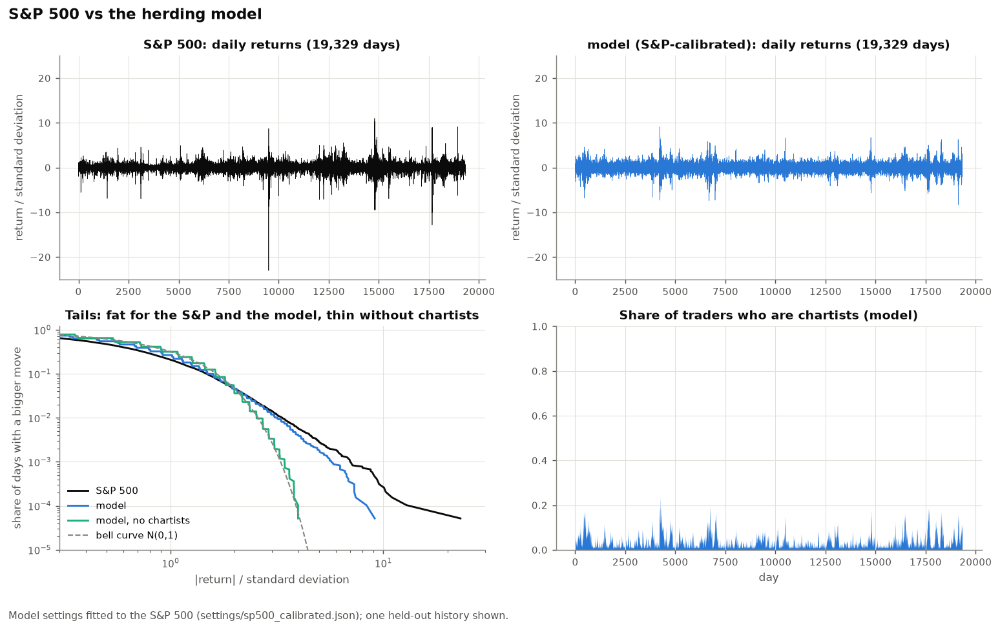

**fig00 — S&P 500 vs the herding model** (made by `main.py`). On the top row, real
daily moves (left) sit next to one model history (right). Both show bursts of wild
days. Bottom left: big moves are far more common than a bell curve predicts, for both
the S&P and the model. With no chartists (green), the model falls back onto the bell
curve. Bottom right: the bursts appear when the share of chartists spikes.

---

## 1. Does the model pass the checks from the proposal?

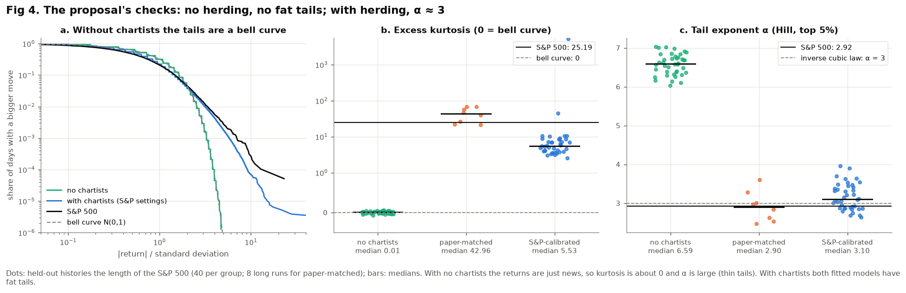

**fig04 — The proposal's checks.**
- **No chartists:** the returns are a plain bell curve (kurtosis 0.01). ✅
- **With herding:** the tail exponent is about 3 (3.10 for the S&P-calibrated model,
  2.92 for the real S&P). This is the "inverse cubic law." ✅

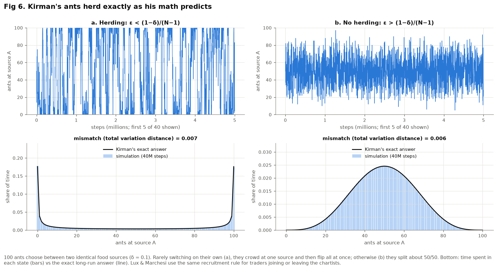

**fig06 — Kirman's ants.** This simulates the simple herding rule the model is built
on and compares it with Kirman's exact formula. The simulation and the formula agree
almost perfectly, which shows the herding code is right.

---

## 2. Does the model look like a real market?

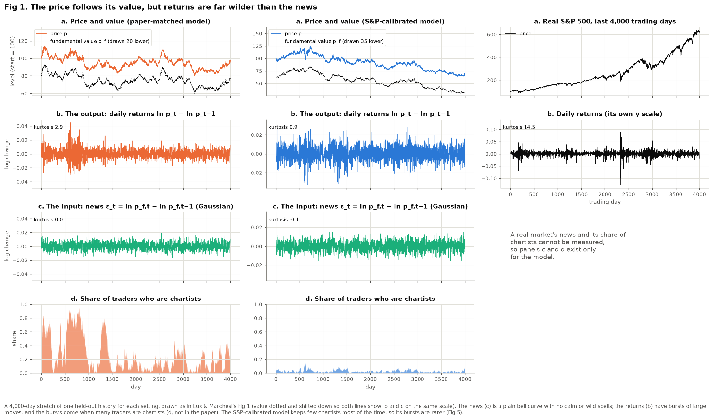

**fig01 — The price follows its value, but returns are wilder than the news.** The
news that moves the true value is a calm bell curve. The price's daily moves have
bursts, and the bursts line up with times when many traders are chartists. The third
column is the real S&P 500, which is wilder still.

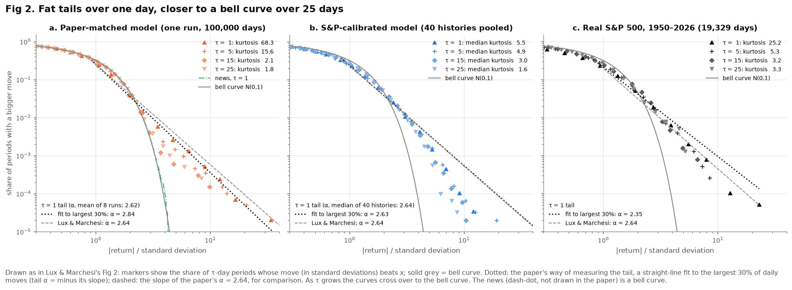

**fig02 — Fat tails over a day, a bell curve over weeks.**
- Daily moves have fat tails.
- Added up over 25 days, the model's moves look like a bell curve again, as the paper
  found.
- The real S&P keeps some fat tails even at 25 days. This is one place where the
  model and the real market differ.

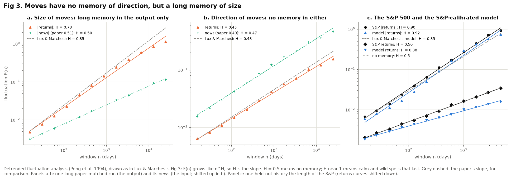

**fig03 — No memory of direction, long memory of size.**
- You can't predict whether tomorrow goes up or down.
- You *can* predict that a wild day is likely to be followed by more wild days.
- The traders create that memory: the news has none.

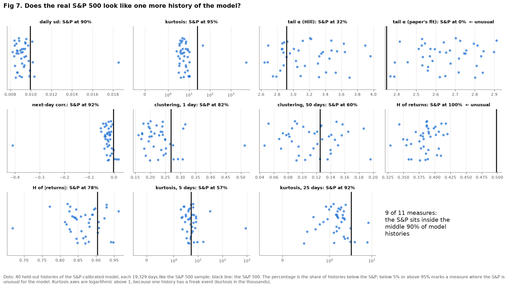

**fig07 — Is the S&P 500 a typical history of the model?** The model was run 40 times.
For each of 11 measures, the figure shows where the real S&P falls among those 40
runs. It looks typical on 9 of the 11 measures.

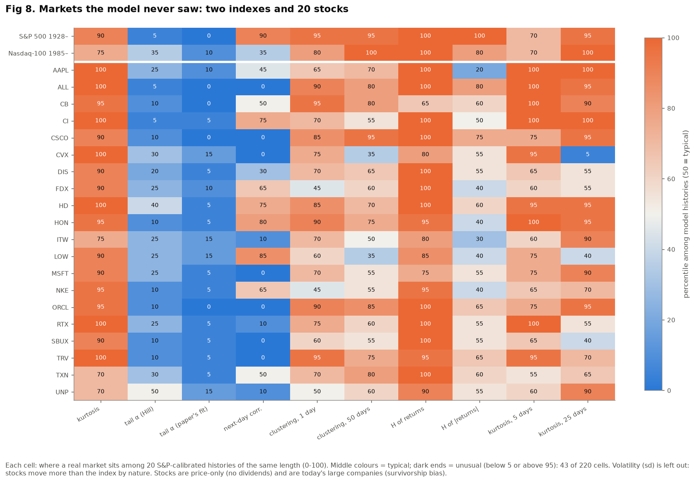

**fig08 — Markets the model never saw.** The same test, applied to the Nasdaq-100, the
S&P since 1928 and 20 individual stocks. These are markets the model was never fitted
to. It mostly holds up. Single stocks have bigger jumps (company news), and the 1930s
were wilder than anything since.

---

## 3. Why do crashes happen?

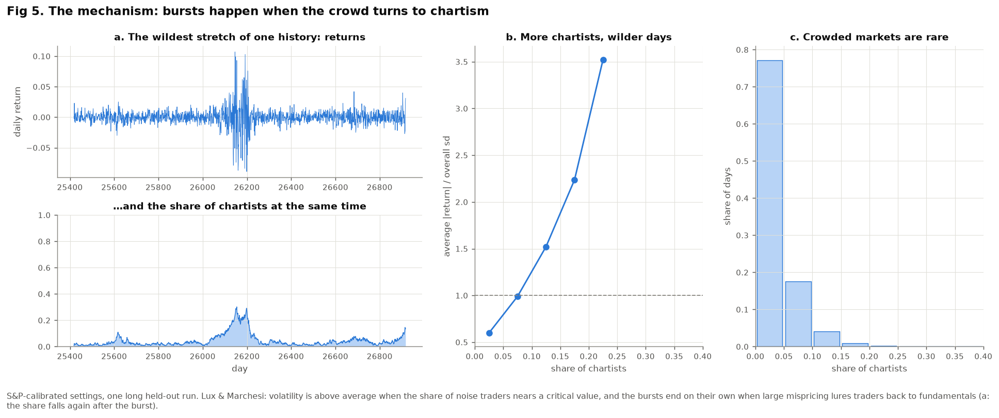

**fig05 — The mechanism.** The more traders are chartists, the bigger the daily moves:
up to 3.5× the average when 20–25% are chartists. Crowded markets are rare, and each
burst ends on its own once the crowd drifts back.

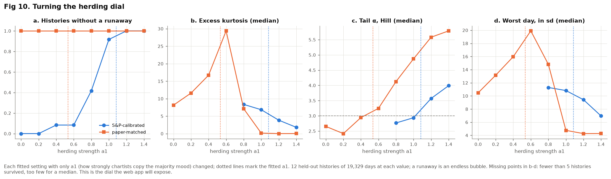

**fig10 — Turning the herding dial.** Only the herding strength (a1) is changed.
Surprise: more herding does **not** always mean more crashes. For the paper-matched
model, the tails are fattest at a middle setting and go back to a bell curve at
strong herding. This dial is what the future web app will let users turn.

---

## 4. How robust is it, and can policy help?

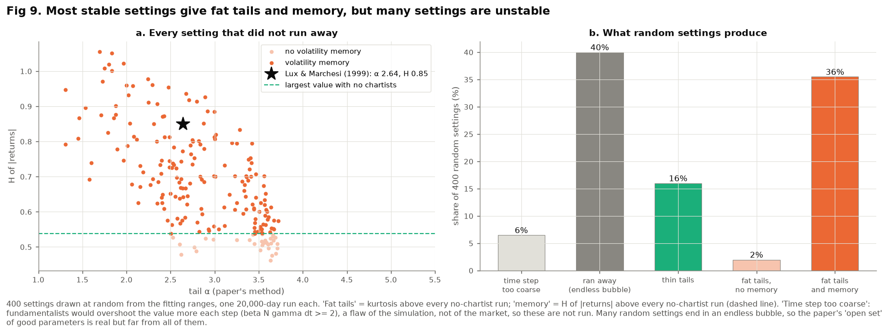

**fig09 — How robust is it?** The figure covers 400 random settings.
- Of the settings that stay stable, 66% give both fat tails and long memory. So the
  result isn't a lucky single setting.
- Many settings run away into an endless bubble, though. Stability is the main limit.

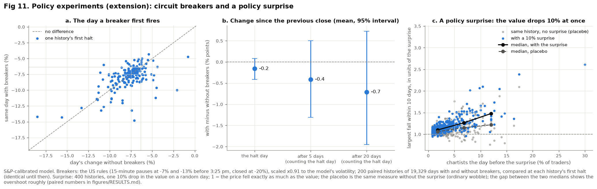

**fig11 — Policy experiments** (an extension beyond the paper).
- **Circuit breakers** (trading pauses after a big fall) had no measurable effect on
  the day of the pause or in the weeks after.
- **A surprise 10% drop in true value** (like an unexpected rate hike) makes the price
  overshoot more when many traders are chartists.

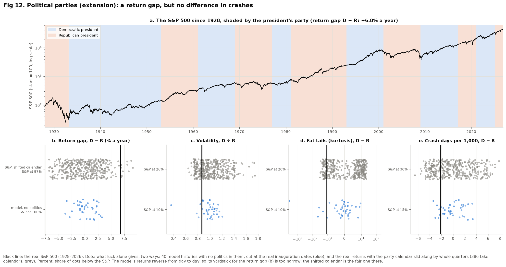

**fig12 — Political parties** (an extension beyond the paper).
- Since 1928 the S&P returned about 6.8% a year more under Democratic presidents. That is
  more than 97% of "fake" party calendars give, so it's borderline: only 12 changes of party.
- Crashes, volatility and fat tails show **no** party difference, so herding works the
  same whoever is president.
