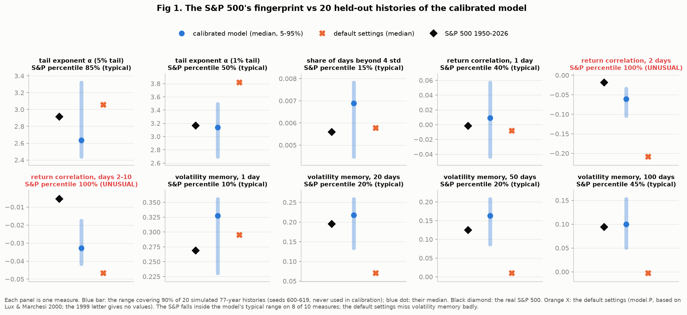
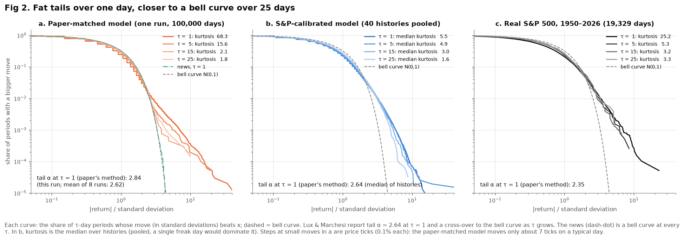
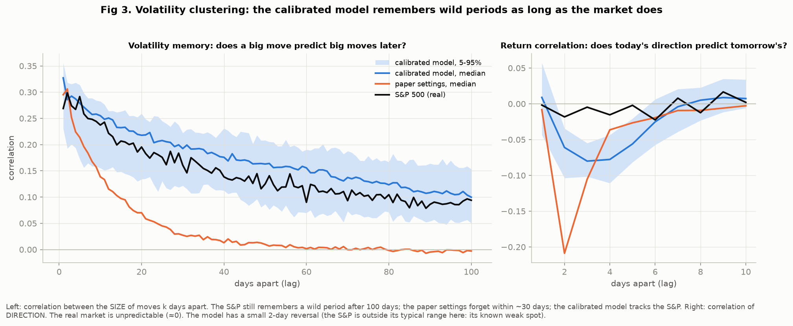
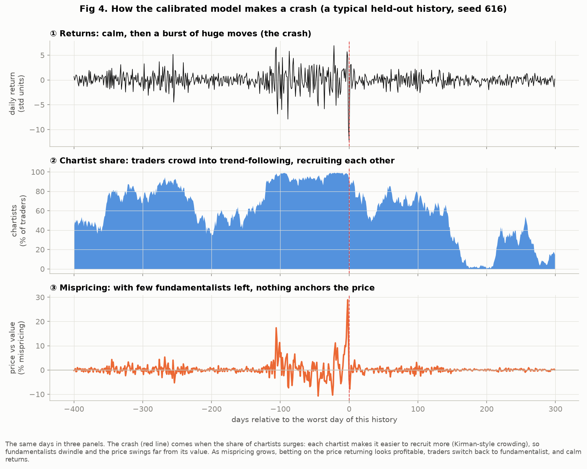
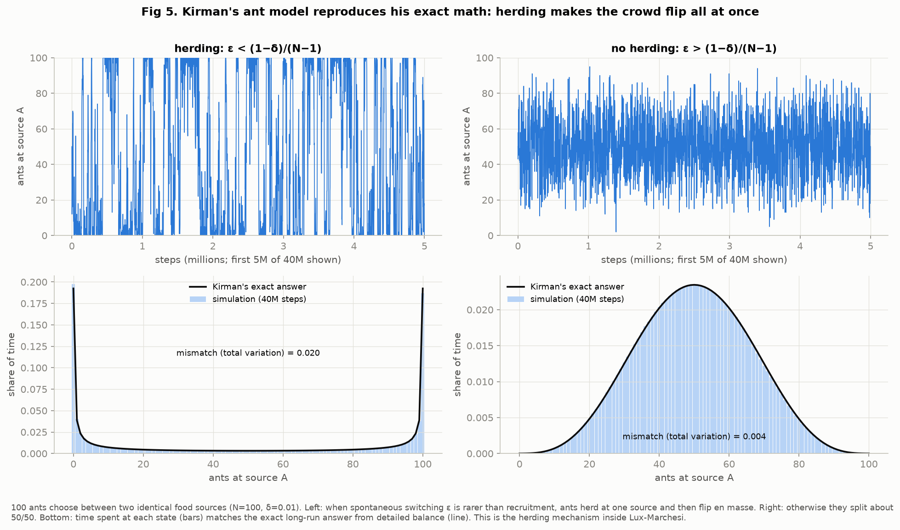
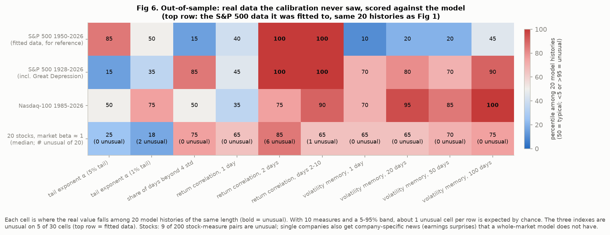
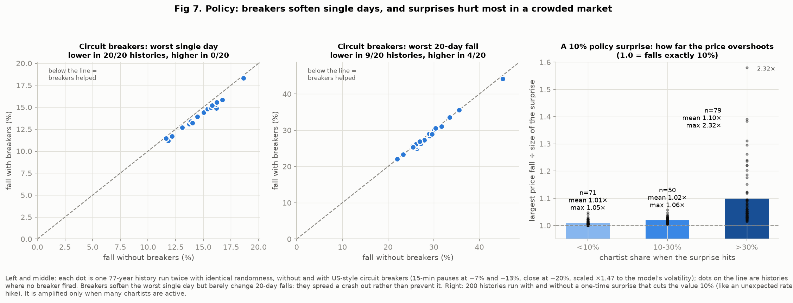
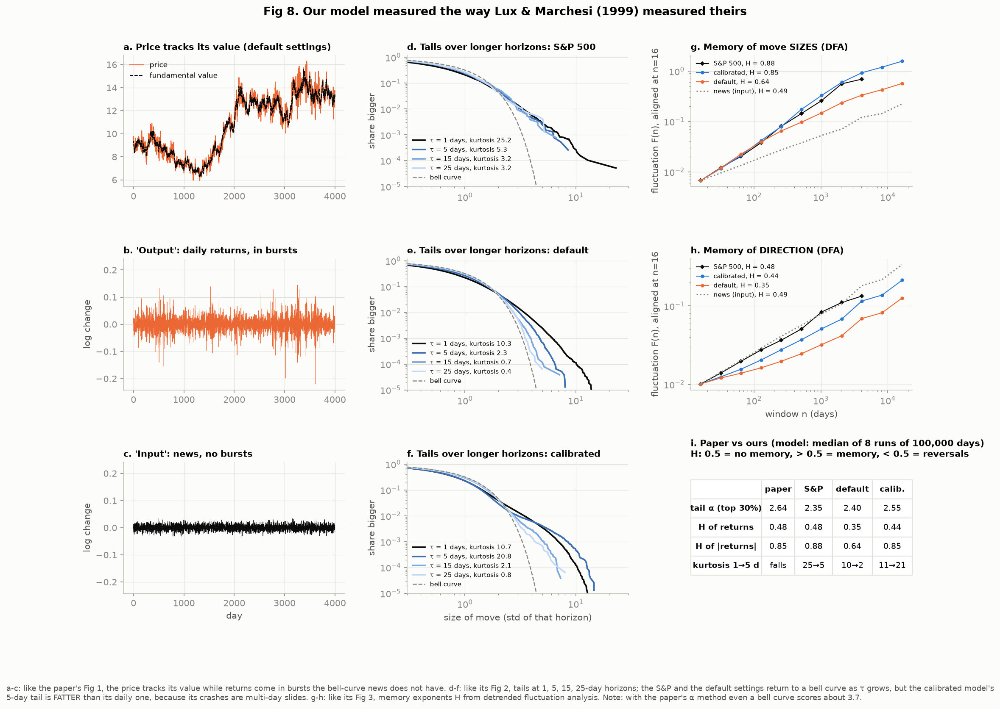
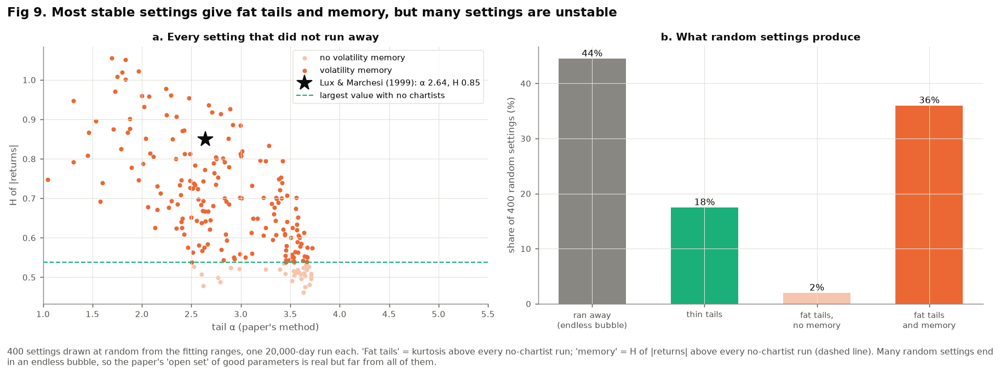

# Results: Can herding explain market crashes?

**Model version:** calibration v3 (November 2026). The switching chance is the exact `1 − e^(−rate)` instead of `min(1, rate)`, and the time step is `dt = 0.01` (100 trading steps a day), refitted to the S&P 500. The previous version (v2, `dt = 0.02`) is in `analysis/history/calibration_v2_dt002.json`. See limitation 6.

All figures are made by `python3 make_figures.py` (about 4 minutes). `figures/draft.png` is the quick overview made by `python3 main.py`. Every model check
uses **held-out seeds** that the calibration never saw, so the model is not graded on
its own homework. Colors mean the same thing in every figure:

| Color | Meaning |
|---|---|
| Black | the real market (S&P 500 or other real data) |
| Blue | the **calibrated** Lux–Marchesi model (settings fitted to the S&P 500) |
| Orange | the model with the **default settings** (`model.P`, based on Lux & Marchesi 2000 but partly changed by us; the 1999 Nature letter gives no parameter values) |
| Aqua | the model with **no chartists** (bell-curve news only; the base case) |
| Gray dashes | reference lines (bell curve, slope −3) |

**Key vocabulary**
- **Fundamentalist:** a trader who buys when the price is below the company's true value and sells when it's above.
- **Chartist:** a trader who ignores value and follows the trend and the crowd.
- **Fat tail:** big days happen far more often than a bell curve says.
- **Tail exponent α:** how fast big days become rare; smaller α means more crashes, and real markets have α ≈ 3.
- **Kurtosis:** one number for how fat the tails are; 0 for a bell curve, larger = more extreme days.
- **H (self-similarity / Hurst exponent):** a memory number from detrended fluctuation analysis. 0.5 = no memory, above 0.5 = what happened persists, below 0.5 = it tends to reverse.
- **Volatility clustering / memory:** big moves come in bunches, so a wild day predicts more wild days later.
- **Percentile:** where the real value falls among 20 simulated histories. 50% is perfectly typical; below 5% or above 95% is unusual.

---

## Fig 1. The S&P 500's fingerprint vs the calibrated model

**Question:** does the real S&P 500 (1950–2026) look like a typical history of the model?

**How to read it:** each of the 10 panels is one measure of how a market behaves.
- The **blue bar** spans 90% of 20 simulated 77-year histories, and the blue dot is their median.
- The **black diamond** is the real S&P 500.
- The **orange X** is the default settings.

**Result:**
- The real S&P sits inside the calibrated model's typical range on **8 of 10** measures.
- The two misses are the **2-day** and **days 2–10 return correlations**. After a big move, the model partly reverses it over the next few days, and the real market barely does. This is the model's known weak spot.
- The default settings miss badly on volatility memory at 20, 50 and 100 days. They forget wild periods almost immediately.

## Fig 2. Fat tails

**Question:** are big days more common than a bell curve predicts, and does herding cause it?

**How to read it:** this is a log-log plot, which turns a power law into a straight line. The x-axis is the size of a daily move in standard deviations; the y-axis is the share of days with an even bigger move.

**Result:**
- The real S&P and the calibrated model both run along the **slope −3 line** from about 2 to 8 standard deviations, the inverse cubic law found by Gopikrishnan et al. (1998). Moves are 8 times rarer each time their size doubles.
- With **no chartists**, the model's tail drops away exactly like the bell curve.
- **This is the proposal's central check:** the news is a bell curve in both runs, so the fat tail comes from the traders, not the news.
- Black Monday 1987 (23 standard deviations) sits at the far right. The model **does not reach that far**: its biggest day in a 77-year history is about 12 standard deviations (at most 17 across 20 histories), so its tail bends down beyond about 8. Its kurtosis (about 10) is therefore well below the S&P's 25, which one day, Black Monday, dominates.

## Fig 3. Volatility clustering and predictability

**Left, volatility memory:** does a big move today predict big moves k days later?
- The real S&P still "remembers" a wild period after 100 days (correlation about 0.09).
- The calibrated model's median runs slightly above the S&P, but the S&P stays inside the model's 5–95% band at every lag.
- The default settings forget within about 30 days.

**Right, return correlation:** does today's *direction* predict tomorrow's?
- In the real market, no: it's about 0. If direction were predictable, traders would trade the pattern away.
- The model has a small reversal over days 2–5, the same weak spot as in Fig 1.

## Fig 4. How the calibrated model makes a crash

**How to read it:** the same 700 days of one typical held-out history, shown in three panels.

**Result, the crash cycle:**
1. A few traders become chartists, and each one makes it easier to recruit more. Their share snowballs to nearly 100% and stays there for about 100 days before the worst day (panel ②).
2. With almost no fundamentalists left, nothing pulls the price back toward its value. The price swings up to 29% away from it (panel ③), and returns burst to 12 standard deviations (panel ①).
3. Once the price is far from its value, betting on its return looks profitable. Traders drift back to being fundamentalists, and calm returns.

This is the mechanism Lux & Marchesi (1999) describe: volatility rises as the share of noise traders (our chartists) nears a **critical value**, then fundamentalists restore calm. Measured over 20 histories, volatility is 0.67× its average when under 10% of traders are chartists and 2.97× when over 90% are. Unlike the paper's "overcome quickly", some crowded episodes (over 50% chartists) last years: most are short (median 3 days), but the longest is 1,042 days.

**This answers the project question:** in this model, crashes come from *herding into the trend-following strategy* (copying strategy), not from bad news.

## Fig 5. Kirman's ant model (the proposal's first check)

**Setup:** 100 ants choose between two identical food sources. Each step, one ant either switches on its own (probability ε) or is recruited by another ant.

**Result:**
- When spontaneous switching is rarer than recruitment (left), the ants **herd**: most of them sit at one source, then the whole crowd flips.
- Otherwise (right), they split about 50/50.
- In the bottom panels, the time the simulation spends at each state (bars) matches **Kirman's exact formula** (line), with a mismatch of only 0.020 and 0.004.
- This is the recruitment mechanism that Lux–Marchesi uses for traders.

## Fig 6. Out-of-sample test: data the calibration never saw

**How to read it:** each row is a real data series and each column a measure. A cell is the real data's percentile among 20 model histories of the same length. Pale cells are typical; dark red or blue cells with a bold number are unusual. With 10 measures and a 5–95% band, about 1 unusual cell per row is expected by pure chance.

**Rows:**
- **Top row, for reference:** the 1950–2026 S&P 500 that the model was fitted to. It uses the same 20 held-out histories as Fig 1, so its numbers match Fig 1 exactly. It is *not* out-of-sample.
- **S&P 500 from 1928**, including the 1929 crash and the Great Depression.
- **Nasdaq-100** since 1985.
- **20 stocks with market beta 0.9–1.1** (stocks that move about 1-for-1 with the market), summarized as one row: the median percentile, and how many of the 20 stocks are unusual on that measure.

**Result:**
- The two out-of-sample indexes are unusual on **3 of 20 cells**; about 2 are expected by chance. Two are the same reversal weak spot as in Fig 1 (the 1928 S&P's 2-day and days 2–10 correlations). The third is the Nasdaq-100's 100-day volatility memory, which is longer than the model's.
- Stocks are unusual on **9 of 200 stock-measure pairs**, fewer than the 20 expected by chance alone. Most (6) are the 2-day reversal again. Single companies also get company-specific news (earnings surprises, lawsuits) that a whole-market model doesn't have.

**Caveats:**
- The stocks are companies that are large *today*, so failed firms are missing (survivorship bias).
- With only 20 histories a percentile moves in steps of 5%, so a single history more or less can move a cell across the 5% or 95% line. Under the previous calibration, the 1950 S&P's 2-day reversal scored 100% against one set of 20 histories and 90% against another.

## Fig 7. Policy experiments: circuit breakers and a policy surprise

Both experiments use **paired runs**: each history is run twice with identical randomness, once with the policy and once without, so any difference is caused by the policy.

**Left and middle, circuit breakers:**
- **Setup:** the real US rules since 2013 are 15-minute pauses at −7% and −13% and a full-day close at −20%. Here they're scaled ×1.47 to match the model's volatility. Dots below the dashed line mean breakers helped; dots exactly on the line are histories where no breaker ever fired.
- **Result:** breakers lower the **worst single day** in all 20 histories, but only by about 5% on average. The **worst 20-day fall** improves in only 9 of 20 and gets worse in 4. Pauses **spread a crash over more days rather than prevent it**, because they don't change why traders crowd into trend-following.
- This agrees with the SEC staff's finding that the 1997 halts did not clearly stabilize prices.

**Right, a policy surprise (like an unexpected Fed rate hike):**
- **Setup:** 200 histories, with and without a one-time surprise that cuts the company's true value by 10%. It stands in for real events such as an unexpected rate hike, the 1930 tariffs, or the 2011 US credit downgrade. Histories are grouped by how many chartists were active the day before.
- **Calm market** (under 10% chartists): the price falls almost exactly 10% (mean 1.01×, never more than 1.05×).
- **Crowded market** (over 30% chartists): trend-chasers pile on. The fall overshoots by **10% on average** (a 10% surprise becomes about an 11% fall), and over half of these histories overshoot by more than 5%. In the most extreme case the fall more than doubles (2.32×, about a 22% fall).
- **In this model, the timing of a policy surprise matters more than its size.**

## Fig 8. Checking against the original paper (Lux & Marchesi 1999)

**Question:** measured with the paper's own methods, does our model show what the paper's Figs 1–3 show?

**How to read it:** each column copies one figure of the paper.
- **a–c (paper's Fig 1):** 4,000 days with the default settings. The price tracks its value, returns come in bursts, and the news (the input) has no bursts. Our default settings swing harder than the paper's example (days of ±20% against its ±4%).
- **d–f (paper's Fig 2):** tails of returns summed over τ = 1, 5, 15 and 25 days, each scaled by its own standard deviation. The paper, the S&P (kurtosis 25 → 5 → 3 → 3) and our default settings (10 → 2 → 0.7 → 0.4) all **move back toward the bell curve** as τ grows. The calibrated model does **not** at 5 days: its kurtosis rises from 11 to 21 before falling (2.1 at 15 days, 0.8 at 25).
- **g–h (paper's Fig 3):** detrended fluctuation analysis (DFA). The slope of each line is H. The model curves are 100,000-day runs, like the paper's; the S&P has 19,314 days.
- **i:** the paper's numbers against ours (median of 8 runs of 100,000 days).

| | Paper | S&P 500 | Default | Calibrated |
|---|---|---|---|---|
| Tail α (paper's method: regression on the top 30%) | 2.64 | 2.35 | 2.40 | 2.55 |
| H of returns (0.5 = no memory) | 0.48 | 0.48 | 0.35 | 0.44 |
| H of absolute returns (> 0.5 = memory) | 0.85 | 0.88 | 0.64 | **0.85** |
| H of the news (input) | 0.49–0.51 | – | 0.49 | 0.49 |

**Result:**
- **Matches:** the news has no memory (H = 0.49), while move sizes have strong memory. The calibrated model's H = 0.85 is exactly the paper's value, and the S&P's is 0.88. All tail exponents sit near the paper's 2.64.
- **Caveat on α:** the paper's window (top 30% of days) covers mostly the bell-shaped middle, so even a pure bell curve scores about 3.7 with this method. The paper's 2.64 means "fatter than 3.7", and our Hill estimates in Figs 1–2 are the better tail measure.
- **Misses:**
  - Direction has a little reversal (H of returns 0.44; the default settings, 0.35). This is the same weak spot as in Fig 1.
  - The calibrated model's 5-day returns are fatter-tailed than its daily ones. The reason is that its crashes are **slow-motion slides**. The day after a move of more than 3 standard deviations continues it (correlation +0.31), while the S&P bounces back (−0.19). In the model's worst week, 4.5 of 5 days move the same way; in the S&P's, 3 of 5. Real crashes are sudden shocks (Black Monday, 23 std in one day); the model's are several big days in a row.

## Fig 9. Robustness: do fat tails need special settings?

**Question:** the paper says fat tails and volatility memory appear for many settings, not just one tuned set. Is that true of our model?

**How to read it:** each blue dot is one 77-year history with all 10 calibrated settings drawn at random from the calibration ranges; 19 of 200 left the realistic range and are not shown. Aqua dots: 40 runs with no chartists. The shaded bands are as far as any no-chartist run reaches. A blue dot outside both bands has fatter tails *and* longer memory than every bell-curve run.

**Result:**
- **Fat tails are robust:** 178 of 181 settings (98%) have fatter tails than every no-chartist run. The paper's claim holds for tails.
- **Volatility memory is not:** only 83 of 181 (46%) have more memory than every no-chartist run, and only 18% exceed 0.05 (the S&P has 0.20). In our model, long memory needs particular settings. That's why calibration was needed.

---

## Honest limitations
1. **Two-day reversal.** After a big move the model slightly reverses it over the next 2–5 days, and the real market does not (Figs 1, 3, 6).
2. **One market, no individual companies.** The model can't produce company-specific shocks or insider trading.
3. **Changes from the published model.** Log prices, a faster market maker, and minimum group sizes were needed to fix bugs, so the model is not Lux & Marchesi's exact equations. Fundamentalists react to the mispricing |log(value/price)|; the 2000 paper uses |value − price|/price. The two agree for small gaps but differ by a few percent at the 30% mispricings seen in crashes. Chartists follow a **smoothed** trend, the average price change over about the last day (`tau` = 0.93 days in the calibration), where the paper uses the actual price trend. The exact equations are in the paper's Supplementary Information, which we have not yet checked line by line.
4. **Large differences between histories.** Even with the same settings, one 77-year history can be calm and another full of crashes. A single history (including the real one) is weak evidence on its own; that's why every check here uses 20.
5. **Policy experiments are stylized.** Breaker timing rules are simplified (no 3:25 pm cutoff), and a "policy surprise" is a one-time jump in value, not a model of the Fed.
6. **The time step is part of the model.** The model updates traders in small steps of `dt = 0.01` day. Smaller steps still shift the results a little: tail exponent 2.96 at `dt = 0.01` vs 2.60 at 0.005, and 1-day return correlation −0.002 vs +0.024 (median of 32 histories). The calibrated market sits near a tipping point, so small timing details matter. Removing this would need an event-by-event simulation (the Gillespie algorithm), which is future work. Until then, `dt` must not be changed without refitting.
7. **Slow-motion crashes.** The calibrated model's crashes are multi-day slides, where real ones are sudden one-day shocks. So its 5-day returns are fatter-tailed than its daily ones, unlike the paper and the S&P, and its biggest day is about 12 std against Black Monday's 23 (Figs 2, 8). Fixing this would mean changing the model.
8. **A different regime from the paper's example.** The paper's simulation shows frequent, mild bursts. Our calibrated model has rarer, more violent crashes, and some crowded episodes last years. We fitted the S&P 500, which has rare huge days, rather than the paper's example.
9. **Long volatility memory needs particular settings** (Fig 9). The paper reports it for "many" settings; in our model only about half of random settings show it.
