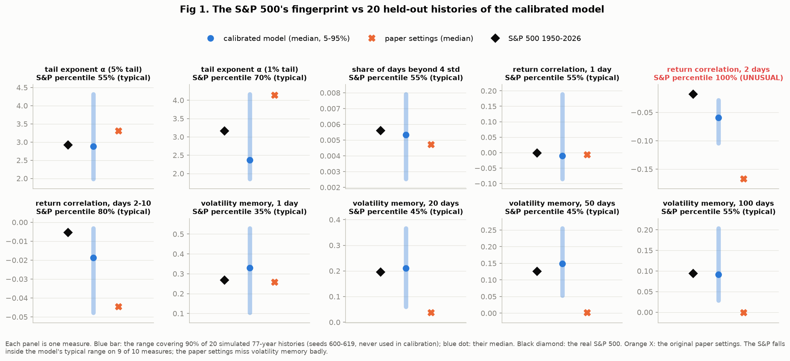
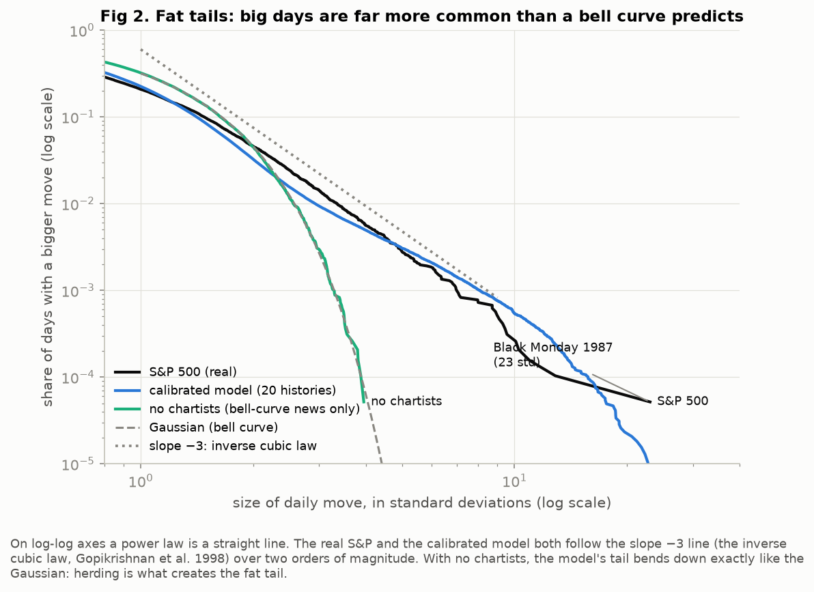
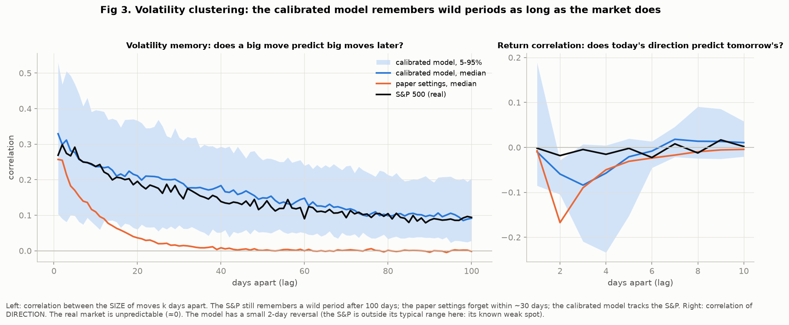
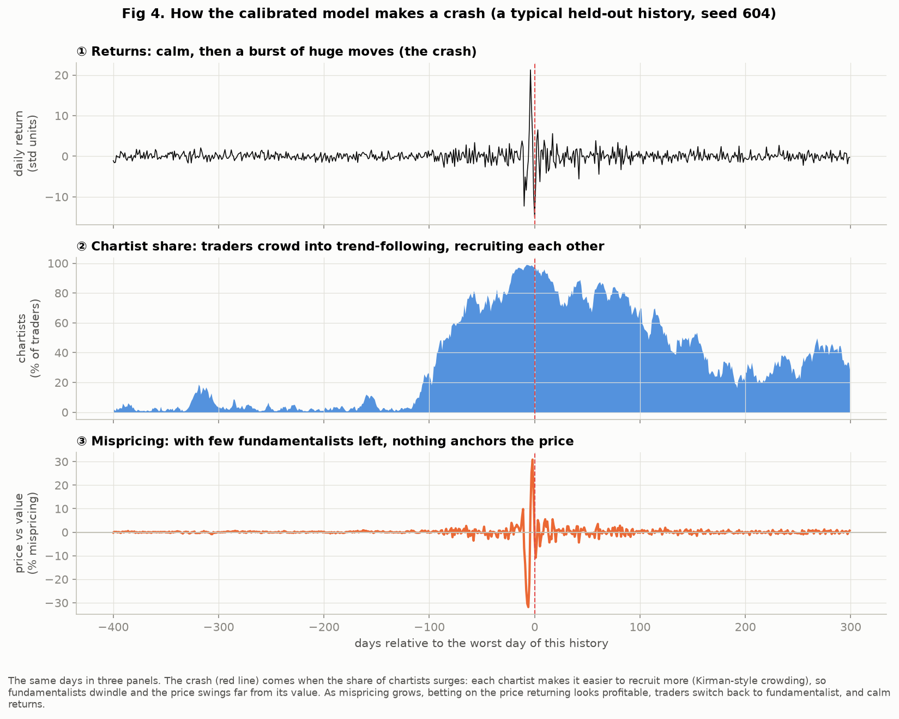
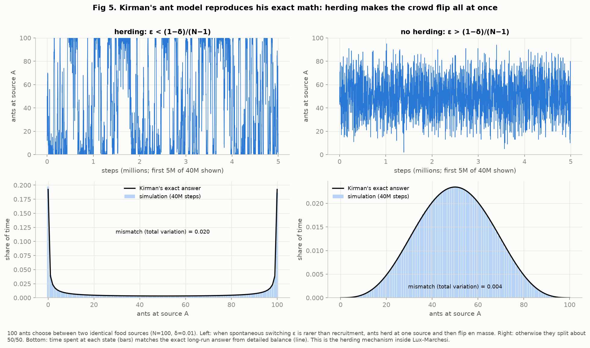
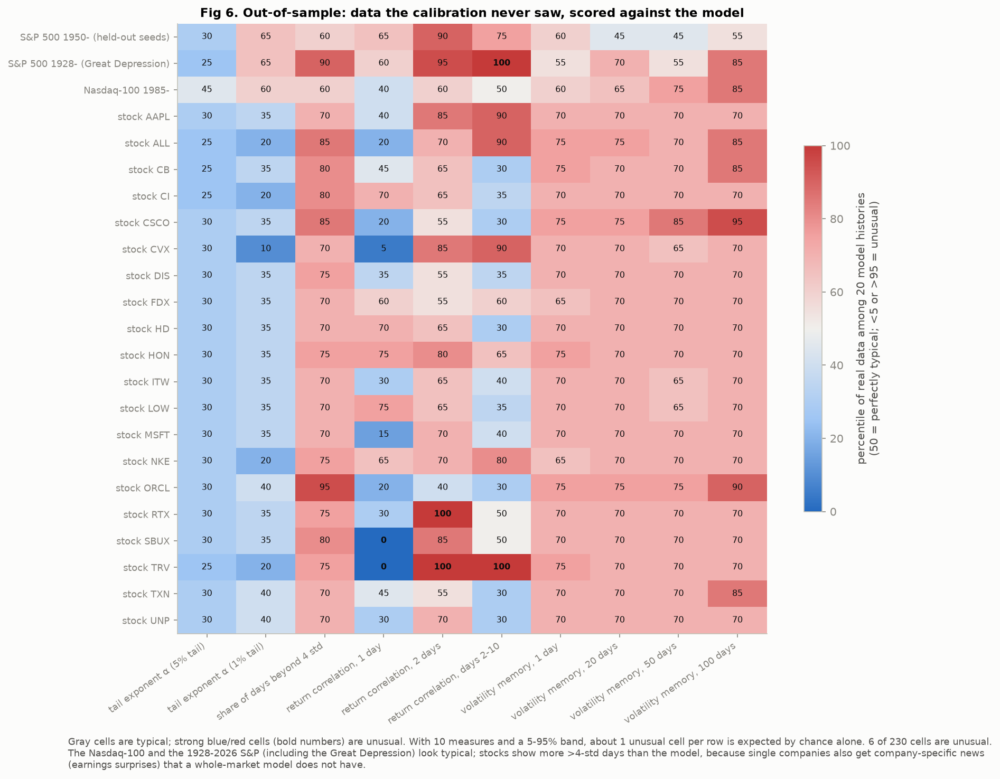
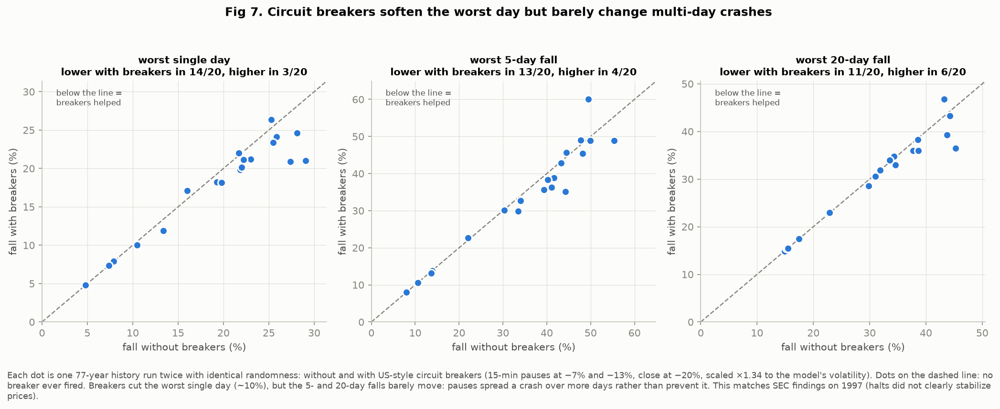
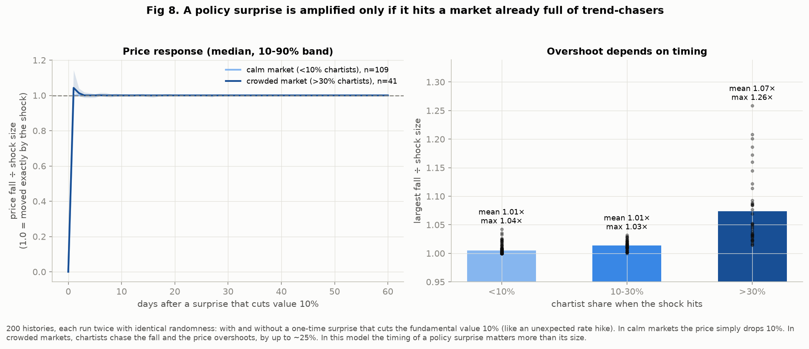

# Results: Can herding explain market crashes?

All figures are made by `python3 make_figures.py` (about 1 minute). Every model check
uses **held-out seeds** that the calibration never saw, so the model is not graded on
its own homework. Colors mean the same thing in every figure:

| Color | Meaning |
|---|---|
| Black | the real market (S&P 500 or other real data) |
| Blue | the **calibrated** Lux–Marchesi model (settings fitted to the S&P 500) |
| Orange | the model with the **original 1999 paper settings** |
| Aqua | the model with **no chartists** (bell-curve news only; the base case) |
| Gray dashes | reference lines (bell curve, slope −3) |

**Key vocabulary**
- **Fundamentalist:** a trader who buys when the price is below the company's true value and sells when it's above.
- **Chartist:** a trader who ignores value and follows the trend and the crowd.
- **Fat tail:** big days happen far more often than a bell curve says.
- **Tail exponent α:** how fast big days become rare; smaller α means more crashes, and real markets have α ≈ 3.
- **Volatility clustering / memory:** big moves come in bunches, so a wild day predicts more wild days later.
- **Percentile:** where the real value falls among 20 simulated histories. 50% is perfectly typical; below 5% or above 95% is unusual.

---

## Fig 1. The S&P 500's fingerprint vs the calibrated model

**Question:** does the real S&P 500 (1950–2026) look like a typical history of the model?

**How to read it:** each of the 10 panels is one measure of how a market behaves.
- The **blue bar** spans 90% of 20 simulated 77-year histories, and the blue dot is their median.
- The **black diamond** is the real S&P 500.
- The **orange X** is the paper's original settings.

**Result:**
- The real S&P sits inside the calibrated model's typical range on **9 of 10** measures.
- The one miss is the **2-day return correlation**: after a big move, the model tends to partly reverse it two days later more than the real market does. This is the model's known weak spot.
- The paper settings miss badly on volatility memory at 20, 50 and 100 days. They forget wild periods almost immediately.

## Fig 2. Fat tails

**Question:** are big days more common than a bell curve predicts, and does herding cause it?

**How to read it:** this is a log-log plot, which turns a power law into a straight line. The x-axis is the size of a daily move in standard deviations; the y-axis is the share of days with an even bigger move.

**Result:**
- The real S&P and the calibrated model both run along the **slope −3 line**, the inverse cubic law found by Gopikrishnan et al. (1998). Moves are 8 times rarer each time their size doubles.
- With **no chartists**, the model's tail drops away exactly like the bell curve.
- **This is the proposal's central check:** the news is a bell curve in both runs, so the fat tail comes from the traders, not the news.
- Black Monday 1987 (23 standard deviations) sits at the far right. The model produces days of 20+ standard deviations too.

## Fig 3. Volatility clustering and predictability

**Left, volatility memory:** does a big move today predict big moves k days later?
- The real S&P still "remembers" a wild period after 100 days (correlation about 0.09).
- The calibrated model's median follows the S&P almost exactly.
- The paper settings forget within about 30 days.

**Right, return correlation:** does today's *direction* predict tomorrow's?
- In the real market, no: it's about 0. If direction were predictable, traders would trade the pattern away.
- The model has a small reversal over days 2–5, the same weak spot as in Fig 1.

## Fig 4. How the calibrated model makes a crash

**How to read it:** the same 700 days of one typical held-out history, shown in three panels.

**Result, the crash cycle:**
1. A few traders become chartists, and each one makes it easier to recruit more. Their share snowballs from about 2% to nearly 100% (panel ②).
2. With almost no fundamentalists left, nothing pulls the price back toward its value. The price swings up to 30% away from it (panel ③), and returns explode to 20 standard deviations (panel ①).
3. Once the price is far from its value, betting on its return looks profitable. Traders drift back to being fundamentalists, and calm returns.

**This answers the project question:** in this model, crashes come from *herding into the trend-following strategy* (copying strategy), not from bad news.

## Fig 5. Kirman's ant model (the proposal's first check)

**Setup:** 100 ants choose between two identical food sources. Each step, one ant either switches on its own (probability ε) or is recruited by another ant.

**Result:**
- When spontaneous switching is rarer than recruitment (left), the ants **herd**: most of them sit at one source, then the whole crowd flips.
- Otherwise (right), they split about 50/50.
- In the bottom panels, the time the simulation spends at each state (bars) matches **Kirman's exact formula** (line), with a mismatch of only 0.020 and 0.004.
- This is the recruitment mechanism that Lux–Marchesi uses for traders.

## Fig 6. Out-of-sample test: data the calibration never saw

**How to read it:** each row is a real data series and each column a measure. A cell is the real data's percentile among 20 model histories. Gray means typical; strong blue or red with a bold number means unusual. With 10 measures and a 5–95% band, about 1 unusual cell per row is expected by pure chance.

**Result:**
- Only 6 of 230 cells are unusual, fewer than chance alone would produce.
- The **Nasdaq-100** looks typical on every measure, and so does the **S&P 500 from 1928**, including the 1929 crash and the Great Depression, except one cell (the reversal again).
- The **20 stocks with market beta 0.9–1.1** (stocks that move about 1-for-1 with the market) mostly look typical. Some show more extreme days than the model. That's expected: single companies also get company-specific news (earnings surprises, lawsuits) that a whole-market model doesn't have.

**Caveat:** the stocks are companies that are large *today*, so failed firms are missing (survivorship bias).

## Fig 7. Policy experiment 1: circuit breakers

**Setup:**
- Each dot is one 77-year history, run twice with **identical randomness**: once without and once with US-style circuit breakers. The real rules since 2013 are 15-minute pauses at −7% and −13% and a full-day close at −20%; here they're scaled ×1.34 to match the model's volatility.
- Dots below the dashed line mean breakers helped.
- Dots exactly on the line are histories where no breaker ever fired.

**Result:**
- Breakers lower the **worst single day** in 14 of 20 histories, by about 10%.
- But the **worst 5-day and 20-day falls** barely change: only 11 of 20 histories improve over 20 days, close to a coin flip.
- Pauses **spread a crash over more days rather than prevent it**, because they don't change why traders crowd into trend-following.
- This agrees with the SEC staff's finding that the 1997 halts did not clearly stabilize prices.

## Fig 8. Policy experiment 2: a policy surprise (like an unexpected rate hike)

**Setup:**
- 200 histories, each run twice with identical randomness: with and without a one-time surprise that cuts the company's true value by 10%.
- The surprise stands in for real events such as an unexpected Fed rate hike, the 1930 tariffs, or the 2011 US credit downgrade.

**Result:**
- In a **calm market** (under 10% chartists), the price simply falls 10%, exactly the size of the surprise.
- In a **crowded market** (over 30% chartists), trend-chasers pile on and the fall **overshoots by up to about 25%**: a 10% surprise becomes about a 12.5% fall.
- **In this model, the timing of a policy surprise matters more than its size.** The same news is harmless in a calm market and amplified in a crowded one.

---

## Honest limitations
1. **Two-day reversal.** After a big move the model slightly reverses it over the next 2–5 days, and the real market does not (Figs 1, 3, 6).
2. **One market, no individual companies.** The model can't produce company-specific shocks or insider trading.
3. **Changes from the 1999 paper.** Log prices, a faster market maker, and minimum group sizes were needed to fix bugs, so the model is not the paper's exact equations.
4. **Large differences between histories.** Even with the same settings, one 77-year history can be calm and another full of crashes. A single history (including the real one) is weak evidence on its own; that's why every check here uses 20.
5. **Policy experiments are stylized.** Breaker timing rules are simplified (no 3:25 pm cutoff), and a "policy surprise" is a one-time jump in value, not a model of the Fed.
